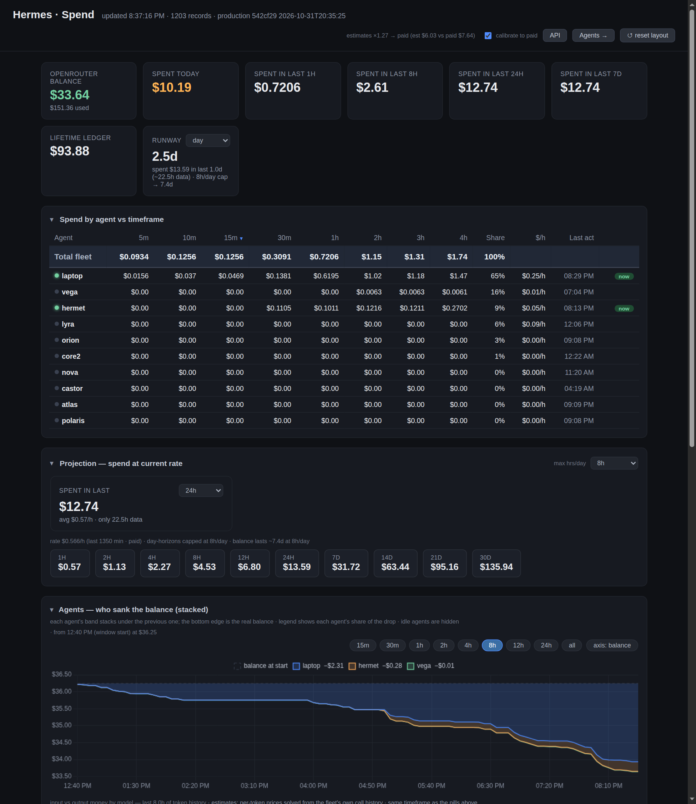

# Hermes Spend Dashboard

A self-hosted dashboard for the money your Hermes agent fleet (multiple hermes agents connected to telegram) burns through an
OpenRouter account: balance, spend by window, runway, per-agent split, per-model
tokens, projections — and a small read-only JSON API so other agents can pull
the numbers.



- **Real money first.** The headline figures are the actual drop in the
  OpenRouter balance. Where the balance API hasn't moved yet (it lags), the
  dashboard falls back to the agents' own cost estimates and says so.
- **Per-agent, per-model, per-task.** Everything is derived from each Hermes
  `state.db` (SQLite) — no agent cooperation needed.
- **Honest by construction.** Windowed figures are history deltas, never
  invented: a short window says "collecting…", a partial one shows its real
  coverage, and estimates carry a visible calibration factor.
- **No dependencies.** Python 3 stdlib only + a vendored Chart.js. One process,
  one JSONL file, no database server.

## Quick start

```bash
git clone <this repo> agents-spendings && cd agents-spendings
./install.sh                 # → /opt/agents-spendings on port 8399
# or, with a systemd service (as root):
sudo ./install.sh --dir /opt/agents-spendings --port 8399 --systemd --user $USER
```

The installer discovers `~/.hermes/state.db` and `~/.hermes/profiles/*/state.db`,
writes `agents.json`, runs one test snapshot, and prints the URL.

Without the installer:

```bash
python3 collect.py --once      # one snapshot, print it
python3 collect.py             # collector + web server (default)
python3 collect.py --serve     # web server only
SDASH_PORT=8399 python3 collect.py
```

Charts fill in as the collector ticks: **one history row per 5-minute bucket**.

## Configuration

`agents.json` — who to read, and where:

```json
{
  "agents": [
    { "label": "laptop", "db": "/home/me/.hermes/state.db" },
    { "label": "server", "db": "/home/me/.hermes/profiles/twin/state.db" }
  ],
  "scan_dir": "/opt/agents-spendings/fleet"
}
```

- `agents[]` is explicit (label + `state.db` path).
- `scan_dir` auto-discovers extra agents: every `<dir>/<name>/.hermes/state.db`
  (or `<dir>/<name>/state.db`) becomes an agent labelled `<name>`.
- CLI helpers: `python3 collect.py --agents`, `--agent-add LABEL DB`,
  `--agent-remove LABEL`, `--agent-scan`.
- Without `agents.json` it defaults to `~/.hermes/state.db` (laptop) and
  `~/.hermes/profiles/twin/state.db` (core2).

Environment: `SDASH_PORT` (default 8399), `SDASH_SNAP_TTL` (snapshot cache
seconds), `SDASH_TOKEN` (optional: require `X-SDASH-Token` on writes).

## Agent API

Small, read-only, documented, discoverable:

```bash
curl -s http://HOST:8399/llms.txt          # plain-text guide for LLM agents
curl -s http://HOST:8399/api               # endpoint index
curl -s 'http://HOST:8399/api/summary'     # balance, spend, runway, agents, models
curl -s 'http://HOST:8399/api/agents?window=60'
curl -s 'http://HOST:8399/api/models?window=1440'
```

`window` is in minutes (default 480 = 8h, `0` = all history). `/api/summary` is
~2 KB; `/data` is the full raw payload (~1 MB). Discovery is wired into the HTML
(`<meta name="ai-api">`, `<link rel="alternate">`), the HTTP `Link:` header, and
`/llms.txt`. Details: [docs/API.md](docs/API.md).

## How the numbers are made

```
state.db (per agent, SQLite)
   └─ ledger: one row per (session, model, task) with cost + in/out/cache/reasoning tokens
        └─ snapshot.py  → lifetime totals per agent/model/task  (+ balance from OpenRouter)
             ├─ history.jsonl  one row per 5-min bucket (cumulative totals + balance)
             └─ /data, /api    JSON for the UI and agents
                  └─ frontend: window figures = delta(last) − delta(base), client-side
```

- **Balance spend** = OpenRouter credit drop between the window's first and last
  balance sample. Trustworthy; the API marks it `source: "paid"`.
- **Ledger spend** = sum of the agents' recorded costs, priced from the
  provider's list price. An estimate: cache pricing and upstream routing make it
  drift from the bill, so the UI shows a calibration factor (paid ÷ estimate).
- **Per-agent attribution** can only come from the ledger — provider billing is
  account-wide. The agents chart therefore stacks each agent's share from the
  balance at the window start down to the real balance.
- **Token history**: `by_model_tokens` per bucket (measured). Rows older than
  that feature can be backfilled with `scripts/backfill_tokens.py`, which
  attributes each ledger record's tokens to its last-activity bucket.

## Panels

| panel | what it answers |
|---|---|
| hero cards | balance, spent today / 1h / 8h / 24h / 7d, lifetime ledger, runway |
| Spend by agent vs timeframe | per-agent spend in 5m…4h + share + rate; sortable |
| Projection | spend at the current rate over 1h…30d, with an hours-per-day cap |
| Agents — who sank the balance | stacked: each agent's share of the drop, bottom edge = real balance; switchable to a "money spent" axis |
| input vs output money by model | token-type split of the window's spend (prices solved from your own call history) |
| Models — spend by timeframe & lifetime | per model: window spend, lifetime, share, calls, in/out/cache/reasoning |
| OpenRouter balance over time | the real credit line |
| Sessions explorer | per-session cost, tokens, models, tasks |

One timeframe (default 8h) drives every windowed widget; panels are draggable
and collapsible, and the layout is remembered per browser.

## Scripts

| script | purpose |
|---|---|
| `install.sh` | install/upgrade + optional systemd unit |
| `scripts/dev.sh` | run a dev instance beside prod |
| `scripts/dev.sh` | move `state.db` snapshots between hosts |
| `scripts/repair_history.py` | rebuild/compact `history.jsonl` |
| `scripts/backfill_tokens.py` | add `by_model_tokens` to older history rows |
| `_audit.py` | consistency audit of the history file |

## Troubleshooting

- **Charts empty on first start** — normal: they need a few 5-minute buckets.
- **"collecting…" in a card** — the window isn't covered by history yet (or the
  fleet's agent set changed); the tooltip states the real coverage.
- **Balance flat / spend shows `ledger`** — OpenRouter's balance endpoint lags;
  the fallback is deliberate and labelled.
- **An agent shows `MISSING`** — `python3 collect.py --agents` prints which
  `state.db` paths don't exist; fix `agents.json`.
- **Port already in use** — `SDASH_PORT=8400 python3 collect.py` runs a second
  instance (its own history file), handy for testing.
